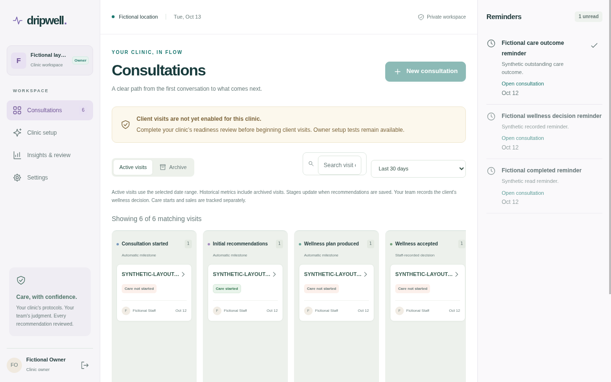

# TASK108 bounded native Reporting snapshot evidence

The sole corrected private run passed16 affected Node controls and one shared actual parent validation, then failed the native Reporting ancestor guard. This is diagnostic evidence, not an accepted whole UI or pilot story. The current independent [audit](../../AUDIT_NATIVE_REPORTING_SNAPSHOT.md) was FULL-read and genuinely adopted by Root at2026-10-13T01:48:22.545134Z. Original late and oversized reports remain unadopted.

[Safe native receipt](hit-first-failure.json):704bytes, SHA256090b2dc845a5afea8c3598cebe9a8306b541a934ffcdf7bc49e3051619068da8. PRE_SCROLL_TREE records uniquely matched selected SUMMARY, hit DIV and terminal DOCUMENT. Original1280x800, box255/674.5625/700/21.6875, point605/685, differing frontend, sameframe,7hops ending MISSING_PARENT and source-correlated input0 remain. Which DIV, actual nativefrontend0, freshness, after-scrollpixels, rawdispatch and cause are UNKNOWN. Synthetic controls are separate from this native result.

Actual current first image:108146bytes/SHA256b07a061a3e0e4ad1344bec211adeaff4c8ff1dff35d6bda4db1dcd487dfc33a7,1280x800. Root and Auditor actually viewed its original bytes. Its difference from the prior image has unknown cause. The actual last image is byte-identical to the existing [TASK106 last board](../task106/desktop-last-board.png):103647bytes/SHA256a2e5810730a39b8f37909e555681e8523b5127a869b2da6d119f1211be1f8b5f. Both precede click scrolling and cannot prove the hit target at605,685. Three desktop states, zero complete cases; Reporting-open/closed and mobile are unverified.

[Adapter](adapter.mjs.txt)203250/a2881a57 and [supervisor](supervisor.py.txt)41883/3390f24d are exact inactive `.txt` copies of corrected source. Unchanged fixture remains private. They preserve original guards/getter ordering/first-error handling and use existing acquired rows without a new query or second ancestry walk. Diagnostic frontend mirrors accept zero; owned actionable/root/backend guards retain their original restrictions. The composed zero-mirror control and separate pure terminal-zero branch establish their stated contracts, not native zero occurrence.

Native owned-group release records30ACK/0unknown/0outstanding and known process/listener closure only. Global/per-thread/socket/rawdispatch/remotehandle absence is not proved. Exact immutable RESULT/ADAPTER/context/marker/raw states/metafile/control receipts stay private, with no browser profiles, capabilities or clinical data copied here. The once is spent; no replay is authorized. Application5a9c8dea/first291-test ordinaryCI, passing unrelated checks and reviewed migrations were retained.

All nine pilot stories and production/hosted/privacy/protection/default-disabled/provider/admin/retention gates stay open. Selected external tasks are parked individually. Necessary native Reporting and real AudioRecorder/other-visit/capture-denial work remains internal; the hourly continuation does not establish an uninterrupted worker.
